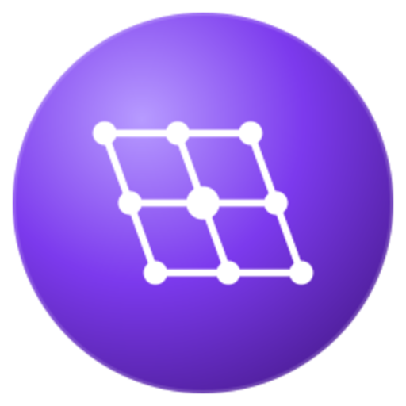

<div align="center">
  

  <h1>Lattica</h1>

  <p><strong>A post-quantum cryptocurrency built on the Bitcoin Core architecture.</strong></p>

  [](COPYING)
</div>

---

Lattica keeps the Bitcoin Core design — a UTXO ledger, Script, full-node
validation, a peer-to-peer network, a built-in wallet — and replaces the
cryptography that a quantum computer breaks.

That replacement is the whole point. In March 2026 a joint whitepaper from
Google Quantum AI, the Ethereum Foundation and Stanford put a number on it: the
256-bit elliptic-curve discrete logarithm, the problem every Bitcoin signature
rests on, falls in minutes to fewer than half a million physical qubits
([arXiv:2603.28846](https://arxiv.org/abs/2603.28846)). NIST has separately
scheduled ECDSA for deprecation after 2030 and disallowance after 2035. Lattica
starts on the other side of that line.

### What is different from Bitcoin

- **Signatures: ML-DSA-44** (FIPS 204), vendored from PQClean. There is no
  elliptic-curve code in the tree at all — `libsecp256k1` is not present.
- **Encrypted transport: ML-KEM-768** (FIPS 203) in the v2 P2P handshake, in
  place of the elliptic-curve exchange of BIP324. On by default, so the wire is
  covered as well as the coins.
- **Hashing: SHA3-256** (FIPS 202) throughout — block and transaction ids,
  Merkle trees — and **SHA3-256d** for proof of work. Address and script hashes
  are `Hash160 = RIPEMD160(SHA3-256)`, Bitcoin's two-stage shape over a SHA3
  inner digest, so the short hash is not a prefix of the long one.
- **Everything else is deliberately unchanged.** The 2016-block difficulty
  retarget, the ten-minute target, the 210 000-block halving, Script. A
  post-quantum chain is already enough novelty for one project.

The cost is honest and worth stating: an ML-DSA-44 input is 3732 bytes against
104 for ECDSA, so a transaction is roughly 17× a Bitcoin transaction, and a
payment costs proportionally more in fees at equal congestion. Nothing about the
signature scheme is free.

## Status

**Mainnet genesis is dated 19 August 2026.** Genesis is mined and the parameters
are fixed. The network is young and thinly connected; consensus rules may still
change while it has little weight behind it, and after that they will not.

The chain begins at **difficulty 1** — the same target Bitcoin's genesis used —
so an ordinary CPU can mine from the first block. On a modern desktop that is a
few minutes per block until the difficulty finds its level.

## Binaries

| Binary | Purpose |
| --- | --- |
| `latticad` | Headless full node and wallet daemon |
| `lattica-cli` | JSON-RPC command-line client |
| `lattica-qt` | Desktop GUI wallet (Qt Widgets) |
| `lattica-miner` | Standalone multi-threaded CPU miner |
| `lattica-miner-gpu` | Standalone OpenCL GPU miner (built when an OpenCL SDK is found) |
| `lattica-wallet` | Offline wallet tool |
| `lattica-tx` | Offline raw-transaction tool |
| `lattica-util` | Offline utility tool |

## Building

CMake and a C++20 compiler (GCC ≥ 12 or Clang ≥ 15). Per-platform instructions
and the dependency list are in [`doc/build-unix.md`](doc/build-unix.md),
[`doc/build-windows.md`](doc/build-windows.md) and
[`doc/dependencies.md`](doc/dependencies.md).

```bash
# deps (Ubuntu 24.04): g++-14 cmake libboost-dev libsqlite3-dev libzmq3-dev
cmake -B build -DCMAKE_BUILD_TYPE=Release
cmake --build build -j"$(nproc)"
ctest --test-dir build              # unit tests
```

The wallet and ZMQ notifications are on by default. The Qt GUI
(`-DENABLE_GUI=ON`) and multiprocess IPC (`-DENABLE_IPC=ON`, Unix only) are
opt-in.

## Running

```bash
# regtest — a private network for development
latticad -regtest -daemon
lattica-cli -regtest getblockchaininfo
lattica-cli -regtest -generate 10
lattica-cli -regtest getnewaddress
```

## Mining

`lattica-miner` fetches work over JSON-RPC, grinds SHA3-256d on every core and
submits the block. `lattica-miner-gpu` is the same miner against an OpenCL
device; it is built only when an OpenCL SDK is present, and the node never
depends on it. Both grind the consensus `CBlockHeader::GetPoWHash`, so a nonce
either miner finds is one the node accepts.

```bash
lattica-miner -benchmark                       # this machine's hashrate
lattica-miner -address=<your address>          # mine to a running latticad
lattica-miner -address=<addr> -threads=4       # or pin the thread count
```

The node's own `generatetoaddress` RPC exists too, but it is single-threaded and
gives up after a million attempts by default — about 0.02% of what one block
needs at difficulty 1. It is meant for regtest, not for mining.

## Network parameters

| | mainnet | testnet | regtest |
| --- | --- | --- | --- |
| P2P port | 12333 | 22333 | 22444 |
| RPC port | 12332 | 22332 | 22443 |
| Address prefix | `L` | `t` | `t` |
| bech32 prefix | `la` | `tl` | `lart` |
| Data directory | `~/.lattica` | | |

## Repository layout

```
src/            node, consensus, wallet, P2P, RPC, crypto
  ML-DSA-44/    vendored FIPS 204 signature implementation
  ML-KEM-768/   vendored FIPS 203 key encapsulation
  qt/           the Qt Widgets GUI
  test/         unit tests (run via ctest)
tools/          offline helpers, including the genesis miner
doc/            build, design and interface documentation
contrib/        tooling and helper scripts
```

## Documentation

Start at [`doc/README.md`](doc/README.md). Design notes are under
[`doc/design/`](doc/design/).

## Contributing and security

Developer notes and coding style: [`doc/developer-notes.md`](doc/developer-notes.md).

Report vulnerabilities as described in [`SECURITY.md`](SECURITY.md) — never in a
public issue.

## License

MIT. See [`COPYING`](COPYING).
